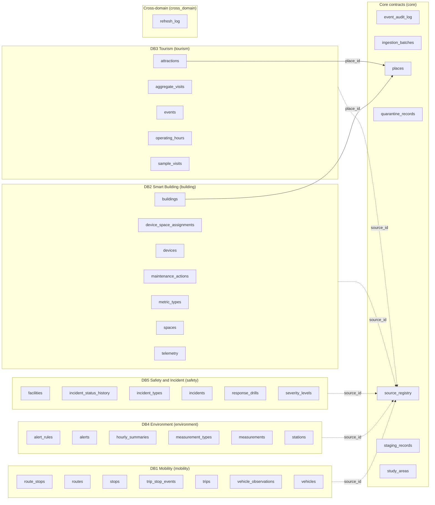
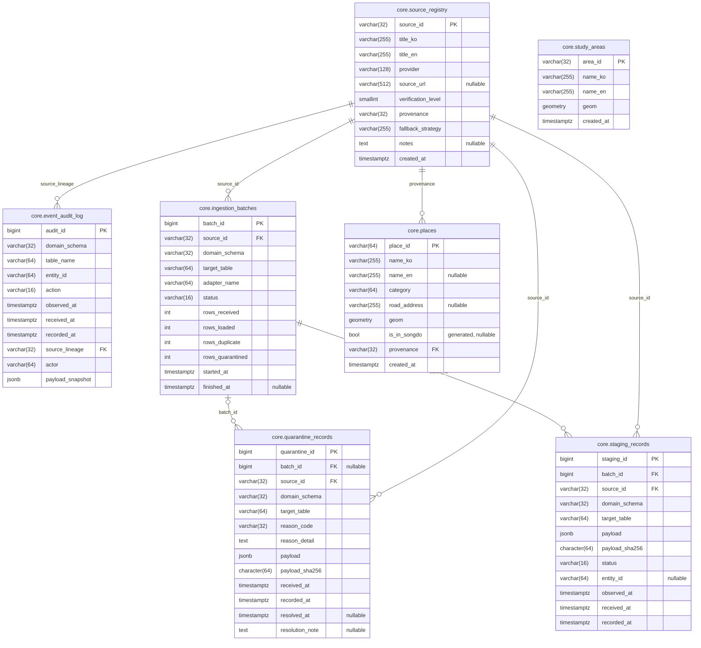
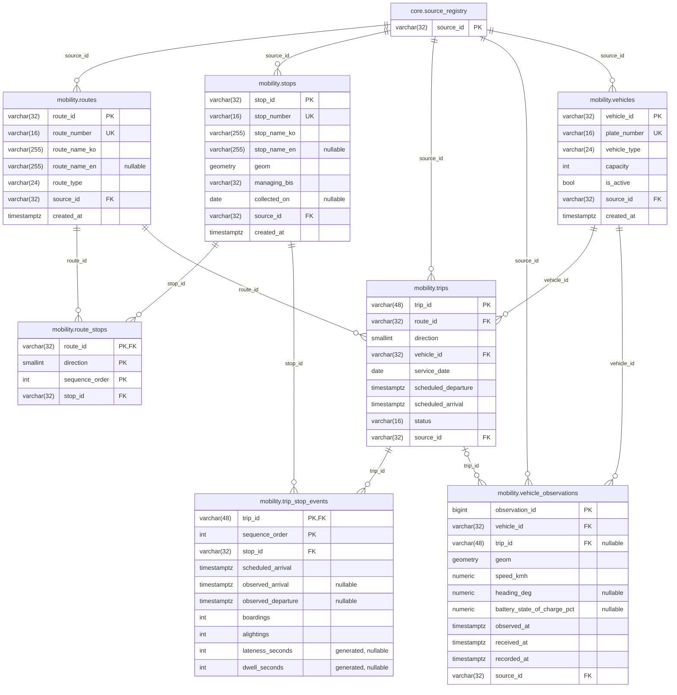
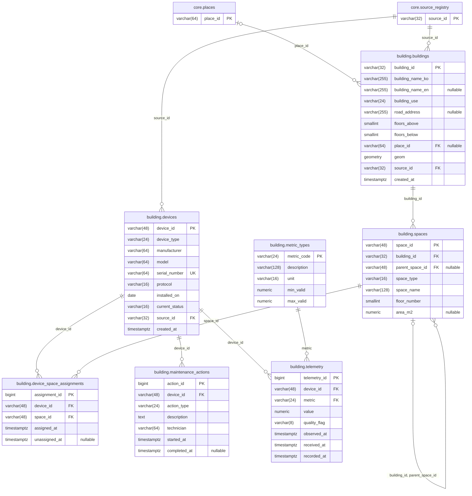
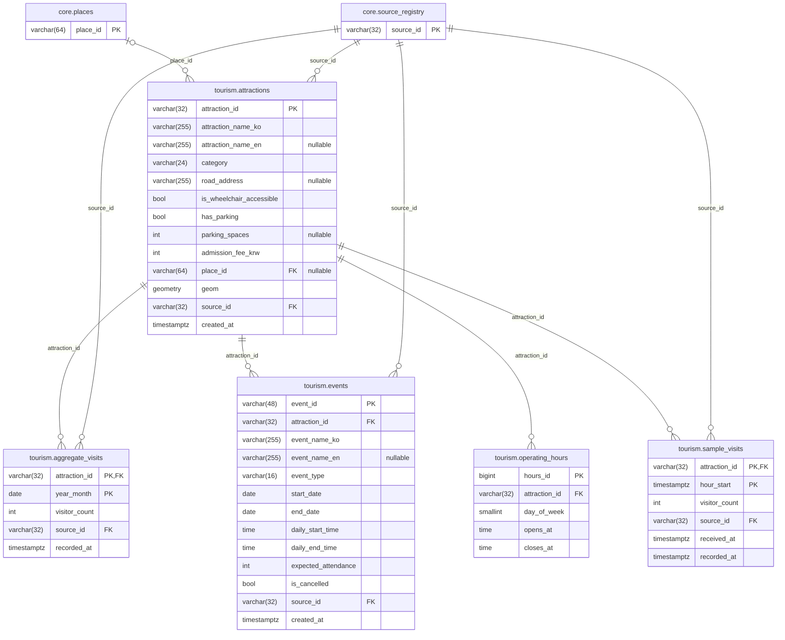
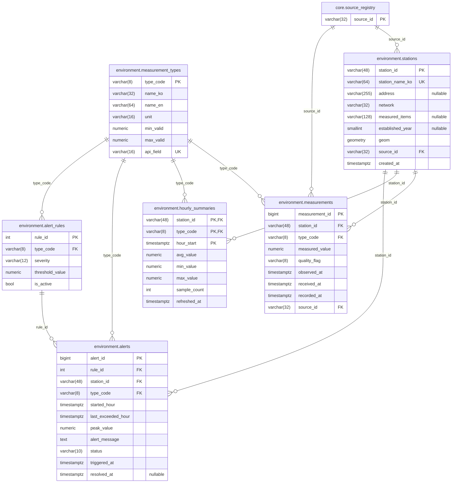
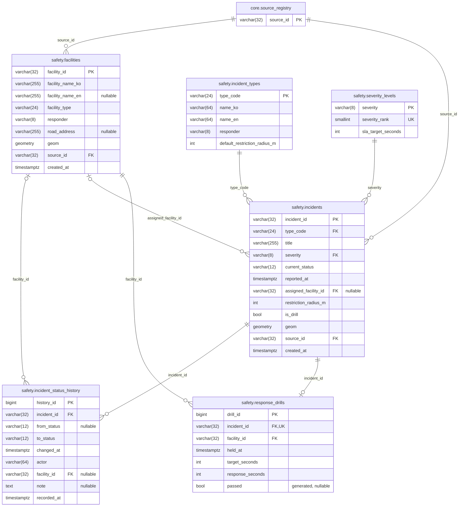

# Entity-relationship diagrams

Generated by `python scripts/erd.py` from the live PostgreSQL catalog, so they match the deployed schema.
39 tables, 58 foreign keys, 3 exclusion constraints, 23 unique constraints, 87 CHECK constraints.

**How to read them** (crow's-foot notation):

| Symbol | Meaning |
|---|---|
| `\|\|` on the parent side | every child row must have a parent (FK is NOT NULL) |
| `\|o` on the parent side | the parent is optional (FK is nullable) |
| `o{` on the child side | a parent has zero or more children |
| `o\|` on the child side | a parent has at most one child (the FK is also unique) |
| `PK`, `FK`, `UK` | primary key, foreign key, single-column unique key |
| label on a line | the foreign-key column(s) in the child table |

Tables from another schema appear with their key only. Every domain table also references
`core.source_registry` through `source_id` (provenance).

## Overview: schema map

Every table, grouped by schema. Only the links that cross schemas are drawn here (the dashed line
stands for the `source_id` reference of every table in that schema); the links inside a schema are
in that schema's own diagram below.

## Core contracts (`core`)

Source registry, canonical places, study area and the ingestion pipeline (batches, staging, quarantine, append-only audit ledger).

| Table | Purpose | Primary key | Foreign keys | Unique / exclusion | CHECK |
|---|---|---|---|---|---|
| `event_audit_log` | Append-only ledger: UPDATE, DELETE and TRUNCATE are rejected by trigger | `audit_id` | `source_lineage` → `core.source_registry` | trigger `trg_audit_no_truncate` trigger `trg_audit_no_update_delete` | 1 |
| `ingestion_batches` | One row per adapter run / API ingestion call | `batch_id` | `source_id` → `core.source_registry` | — | 6 |
| `places` | Canonical Songdo places shared by all domains | `place_id` | `provenance` → `core.source_registry` | — | — |
| `quarantine_records` | Rejected payloads kept verbatim with the reason, never silently dropped | `quarantine_id` | `batch_id` → `core.ingestion_batches` `source_id` → `core.source_registry` | UNIQUE `(source_id, payload_sha256, reason_code)` | 2 |
| `source_registry` | Every dataset that may enter the platform, with its verification level | `source_id` | — | — | 2 |
| `staging_records` | Raw payloads accepted by an adapter. SHA-256 of the canonical JSON makes re-delivery idempotent | `staging_id` | `batch_id` → `core.ingestion_batches` `source_id` → `core.source_registry` | UNIQUE `(batch_id, payload_sha256)` | 2 |
| `study_areas` | Canonical study-area polygons (Songdo teaching bbox) | `area_id` | — | — | — |

## DB1 Mobility (`mobility`)

Stops, routes with ordered stop patterns, vehicles, trips, stop events and GPS history.

| Table | Purpose | Primary key | Foreign keys | Unique / exclusion | CHECK |
|---|---|---|---|---|---|
| `route_stops` | Ordered stop pattern. (route_id, direction, sequence_order) guarantees a gap-free ordering key | `route_id, direction, sequence_order` | `route_id` → `mobility.routes` `stop_id` → `mobility.stops` | UNIQUE `(route_id, direction, stop_id)` | 2 |
| `routes` | Transit routes serving Songdo | `route_id` | `source_id` → `core.source_registry` | UNIQUE `(route_number)` | 1 |
| `stops` | Bus stops inside the Songdo bbox; one row per physical stop pole | `stop_id` | `source_id` → `core.source_registry` | UNIQUE `(stop_number)` | 1 |
| `trip_stop_events` | Arrival/departure of a trip at each stop of its pattern | `trip_id, sequence_order` | `stop_id` → `mobility.stops` `trip_id` → `mobility.trips` | UNIQUE `(trip_id, stop_id)` | 4 |
| `trips` | One scheduled run of a route by one vehicle | `trip_id` | `route_id` → `mobility.routes` `source_id` → `core.source_registry` `vehicle_id` → `mobility.vehicles` | UNIQUE `(route_id, direction, scheduled_departure)` EXCLUDE `ex_trips_vehicle_overlap` | 3 |
| `vehicle_observations` | GPS telemetry history. Point-in-time state is reconstructed with DISTINCT ON (vehicle_id) ... ORDER BY observed_at DESC | `observation_id` | `source_id` → `core.source_registry` `trip_id` → `mobility.trips` `vehicle_id` → `mobility.vehicles` | UNIQUE `(vehicle_id, observed_at)` | 5 |
| `vehicles` | Fleet: buses and autonomous shuttles | `vehicle_id` | `source_id` → `core.source_registry` | UNIQUE `(plate_number)` | 2 |

## DB2 Smart Building (`building`)

Buildings, the space tree, devices with valid-time locations, telemetry and maintenance.

| Table | Purpose | Primary key | Foreign keys | Unique / exclusion | CHECK |
|---|---|---|---|---|---|
| `buildings` | Building registry rows; place_id links each one to its canonical place | `building_id` | `place_id` → `core.places` `source_id` → `core.source_registry` | — | 4 |
| `device_space_assignments` | Valid-time history of device locations. Moving a device closes one row and opens another; nothing is overwritten | `assignment_id` | `device_id` → `building.devices` `space_id` → `building.spaces` | EXCLUDE `ex_assignment_no_overlap` | 1 |
| `devices` | IoT devices; location is NOT stored here, see device_space_assignments | `device_id` | `source_id` → `core.source_registry` | UNIQUE `(serial_number)` | 3 |
| `maintenance_actions` | Work done on a device; an open action has completed_at IS NULL | `action_id` | `device_id` → `building.devices` | UNIQUE `(device_id, action_type, started_at)` | 2 |
| `metric_types` | Unit and plausible range per metric; readings outside the range are flagged SUSPECT | `metric_code` | — | — | 1 |
| `spaces` | Interior spaces as a tree: floors at the root, rooms and plant rooms below | `space_id` | `building_id, parent_space_id` → `building.spaces` `building_id` → `building.buildings` | UNIQUE `(building_id, space_id)` UNIQUE `(building_id, parent_space_id, space_name)` | 4 |
| `telemetry` | Device readings. Any reading also counts as a heartbeat (Scenario DB2-4) | `telemetry_id` | `device_id` → `building.devices` `metric` → `building.metric_types` | UNIQUE `(device_id, metric, observed_at)` | 1 |

## DB3 Tourism (`tourism`)

Attractions, weekly opening hours, events, and visitor counts at two grains.

| Table | Purpose | Primary key | Foreign keys | Unique / exclusion | CHECK |
|---|---|---|---|---|---|
| `aggregate_visits` | Published monthly visitor totals (statistics grain: attraction x month) | `attraction_id, year_month` | `attraction_id` → `tourism.attractions` `source_id` → `core.source_registry` | — | 2 |
| `attractions` | Visitor attractions and venues in Songdo with accessibility metadata | `attraction_id` | `place_id` → `core.places` `source_id` → `core.source_registry` | — | 5 |
| `events` | Scheduled events at an attraction; cancelled events are kept, not deleted | `event_id` | `attraction_id` → `tourism.attractions` `source_id` → `core.source_registry` | — | 4 |
| `operating_hours` | Daily open intervals per weekday; a missing weekday means closed | `hours_id` | `attraction_id` → `tourism.attractions` | UNIQUE `(attraction_id, day_of_week, opens_at)` EXCLUDE `ex_hours_no_overlap` | 2 |
| `sample_visits` | Hourly counts from a sensor sample (grain: attraction x hour). Covers only part of all visitors | `attraction_id, hour_start` | `attraction_id` → `tourism.attractions` `source_id` → `core.source_registry` | — | 2 |

## DB4 Environment (`environment`)

Monitoring stations, pollutant types, measurements, hourly rollup, alert rules and episodes.

| Table | Purpose | Primary key | Foreign keys | Unique / exclusion | CHECK |
|---|---|---|---|---|---|
| `alert_rules` | Hourly-average thresholds per pollutant and severity | `rule_id` | `type_code` → `environment.measurement_types` | UNIQUE `(type_code, severity)` | 2 |
| `alerts` | Threshold exceedance episodes. ACTIVE until an hour at or below the threshold follows | `alert_id` | `rule_id` → `environment.alert_rules` `station_id` → `environment.stations` `type_code` → `environment.measurement_types` | UNIQUE `(rule_id, station_id, started_hour)` | 3 |
| `hourly_summaries` | Hourly statistics of GOOD measurements, per station and pollutant | `station_id, type_code, hour_start` | `station_id` → `environment.stations` `type_code` → `environment.measurement_types` | — | 2 |
| `measurement_types` | Criteria pollutants with unit and plausible range (outside = SUSPECT) | `type_code` | — | UNIQUE `(api_field)` | 1 |
| `measurements` | Pollutant readings. Fault markers never reach this table (quarantined); a corrected packet replaces the value | `measurement_id` | `source_id` → `core.source_registry` `station_id` → `environment.stations` `type_code` → `environment.measurement_types` | UNIQUE `(station_id, type_code, observed_at)` | 1 |
| `stations` | Air-quality monitoring stations inside the Songdo bbox | `station_id` | `source_id` → `core.source_registry` | UNIQUE `(station_name_ko)` | 2 |

## DB5 Safety & Incident (`safety`)

Facilities, incident types and severities, incidents, their status history and drills.

| Table | Purpose | Primary key | Foreign keys | Unique / exclusion | CHECK |
|---|---|---|---|---|---|
| `facilities` | Fire stations, 119 safety centers and police boxes serving Songdo | `facility_id` | `source_id` → `core.source_registry` | — | 4 |
| `incident_status_history` | Append-only log of every status change; the status of any incident at any past time T is read from here | `history_id` | `facility_id` → `safety.facilities` `incident_id` → `safety.incidents` | UNIQUE `(incident_id, to_status)` trigger `trg_history_append_only` | 1 |
| `incident_types` | Incident categories with the responder that handles them and the default closed-off radius | `type_code` | — | — | 2 |
| `incidents` | Emergency reports. current_status is changed only through safety.transition_incident() | `incident_id` | `assigned_facility_id` → `safety.facilities` `severity` → `safety.severity_levels` `source_id` → `core.source_registry` `type_code` → `safety.incident_types` | trigger `trg_incidents_status_guard` trigger `trg_incidents_status_log` | 4 |
| `response_drills` | Dispatch exercises: a simulated incident (is_drill) answered by a facility, scored against a target | `drill_id` | `facility_id` → `safety.facilities` `incident_id` → `safety.incidents` | UNIQUE `(incident_id)` | 2 |
| `severity_levels` | Triage levels; the SLA target is the time allowed from report to arrival on scene | `severity` | — | UNIQUE `(severity_rank)` | 1 |

## Cross-domain views (`cross_domain`)

Views (rounded) and materialized views (double border) and the tables they read. They join the domains
through space and time; no data is copied between schemas. `cross_domain.refresh_log` records every refresh.

```mermaid
flowchart LR
    subgraph sg_building["building"]
        building_buildings["buildings"]
        building_device_space_assignments["device_space_assignments"]
        building_devices["devices"]
        building_spaces["spaces"]
    end
    subgraph sg_core["core"]
        core_places["places"]
    end
    subgraph sg_environment["environment"]
        environment_alerts["alerts"]
        environment_measurements["measurements"]
        environment_stations["stations"]
    end
    subgraph sg_mobility["mobility"]
        mobility_stops["stops"]
        mobility_trip_stop_events["trip_stop_events"]
        mobility_trips["trips"]
        mobility_vehicles["vehicles"]
    end
    subgraph sg_safety["safety"]
        safety_facilities["facilities"]
        safety_incident_status_history["incident_status_history"]
        safety_incident_types["incident_types"]
        safety_incidents["incidents"]
        safety_severity_levels["severity_levels"]
    end
    subgraph sg_tourism["tourism"]
        tourism_attractions["attractions"]
        tourism_events["events"]
    end
    subgraph sg_views["cross_domain"]
        cross_domain_refresh_log["refresh_log"]
        v_mv_facility_response_stats[["mv_facility_response_stats"]]
        v_mv_place_context[["mv_place_context"]]
        v_mv_stop_hourly_service[["mv_stop_hourly_service"]]
        v_v_attractions_events_near_stops(["v_attractions_events_near_stops"])
        v_v_building_devices_with_environmental_context(["v_building_devices_with_environmental_context"])
        v_v_incidents_mobility_environmental_impact(["v_incidents_mobility_environmental_impact"])
        v_v_materialized_view_freshness(["v_materialized_view_freshness"])
    end
    safety_facilities --> v_mv_facility_response_stats
    safety_incident_status_history --> v_mv_facility_response_stats
    safety_incidents --> v_mv_facility_response_stats
    safety_severity_levels --> v_mv_facility_response_stats
    core_places --> v_mv_place_context
    environment_stations --> v_mv_place_context
    mobility_stops --> v_mv_place_context
    safety_facilities --> v_mv_place_context
    tourism_attractions --> v_mv_place_context
    mobility_trip_stop_events --> v_mv_stop_hourly_service
    mobility_trips --> v_mv_stop_hourly_service
    mobility_vehicles --> v_mv_stop_hourly_service
    mobility_stops --> v_v_attractions_events_near_stops
    tourism_attractions --> v_v_attractions_events_near_stops
    tourism_events --> v_v_attractions_events_near_stops
    building_buildings --> v_v_building_devices_with_environmental_context
    building_device_space_assignments --> v_v_building_devices_with_environmental_context
    building_devices --> v_v_building_devices_with_environmental_context
    building_spaces --> v_v_building_devices_with_environmental_context
    environment_measurements --> v_v_building_devices_with_environmental_context
    environment_stations --> v_v_building_devices_with_environmental_context
    environment_alerts --> v_v_incidents_mobility_environmental_impact
    environment_stations --> v_v_incidents_mobility_environmental_impact
    mobility_stops --> v_v_incidents_mobility_environmental_impact
    safety_incident_types --> v_v_incidents_mobility_environmental_impact
    safety_incidents --> v_v_incidents_mobility_environmental_impact
    cross_domain_refresh_log --> v_v_materialized_view_freshness
```

